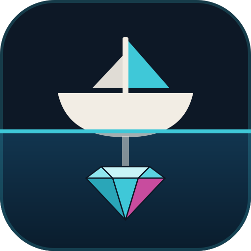

<p align="center">
  
</p>

<h1 align="center">ballast</h1>

<p align="center"><strong>Keeps your portfolio upright.</strong></p>

<p align="center">
  <a href="https://github.com/anderojr/ballast/actions/workflows/ci.yml"></a>
  
  <a href="LICENSE"></a>
</p>

Splits the month's contribution across the assets in your portfolio so it
drifts back toward your allocation targets. Buys only, never sells.

```
 PURCHASES ──────────────────────────────────── contribution R$ 1.500,00
   ▸ buy    3 × B5P211  at R$ 110,12                     R$     330,36
   ▸ buy   10 × VWRA11  at R$ 116,61                     R$   1.166,10
                                                        ──────────────
                                              invested   R$   1.496,46
                                          left in cash   R$       3,54
```

## Why

My allocation follows an idea from John Bogle's *The Little Book of Common
Sense Investing*: split the portfolio between stocks and bonds, let the split
follow your age, and keep things boring. Bogle's rule of thumb is to hold
roughly your age in bonds. I use a slightly more aggressive variant, with
`110 − age` in stocks and the rest in fixed income.

In practice that means one question every month: with this contribution, how
many shares of what? I buy on B3 monthly and on the US market quarterly, and
doing the math by hand got old. I wrote a Python script for it, then rewrote it
in Crystal to learn the language.

## Why "ballast"

Ballast is the weight low in a ship's hull that keeps it upright in rough
water. Bonds play that part in a portfolio: they don't make it go faster, they
keep it from capsizing. Bogle named Vanguard after Nelson's flagship, so a
nautical name felt right.

## How it works

Each asset has a role:

- **target**: gets money until it reaches its share of the total
- **residual**: gets whatever is left (exactly one asset)
- **neither**: only counts toward the total

USD/BRL comes from [AwesomeAPI](https://docs.awesomeapi.com.br/api-de-moedas)
and USD assets from [Finnhub](https://finnhub.io). B3 prices are typed in at run
time, because the broker is real-time and the free APIs lag up to 15 minutes.
The lookups start as soon as the portfolio is read and run while you type, so by
the time the report needs them they're usually there. If an API fails, the
terminal says so and falls back to the price in the file.

Numbers follow the Brazilian format on screen and on input (`R$ 1.500,00`);
`1500.50` also works when typing.

### The split

1. For each asset with a target, the **gap** is how much it's missing to be
   worth `target × (current total + contribution)`. If it's already past it, the
   gap is zero (nothing gets sold).
2. If the gaps fit in the contribution, each target gets its own. If they don't,
   the contribution is split in proportion to the gaps.
3. Each target's money becomes shares, rounded to the nearest one (ties go to
   the even number). It may overshoot the target a
   little, and that's fine, but it never spends more than the contribution.
4. Whatever is left goes to the residual, rounded down. The change stays in cash.

## Install

Needs Crystal 1.21+.

```sh
git clone https://github.com/anderojr/ballast.git
cd ballast
shards build --release
cp bin/ballast ~/.local/bin/   # optional
```

For USD quotes, get a free key at <https://finnhub.io/register> (no card) and
export it in your shell:

```sh
export FINNHUB_API_KEY=your_key
```

Without the key ballast still works: it warns and asks for the USD prices,
suggesting the ones in the file.

## The portfolio file

ballast looks for `portfolio.yml` in the current folder, then in
`~/.config/ballast/portfolio.yml`. For another path, pass `--config`.
`portfolio.example.yml` is a good starting point.

```yaml
usd_rate: 5.20 # fallback, in case AwesomeAPI doesn't answer

assets:
  IVV:
    quantity: 0.50127394
    currency: USD
    price: 776.60 # fallback, in case Finnhub doesn't answer

  VT:
    quantity: 1.05
    currency: USD
    price: 161.54

  VWRA11:
    quantity: 80
    currency: BRL
    price: 116.61 # suggested when ballast asks
    residual: true

  B5P211:
    quantity: 20
    currency: BRL
    price: 110.12
    target: 20% # or 0.2
```

| field          | required    | what it is                                                      |
|----------------|-------------|-----------------------------------------------------------------|
| `quantity`     | yes         | shares you hold today (fractions allowed)                       |
| `currency`     | yes         | `BRL` or `USD`                                                  |
| `price`        | no          | last known price: suggestion or fallback                        |
| `target`       | no          | share of the total the asset should have after the contribution |
| `residual`     | one of them | `true` on the asset that gets what's left                       |
| `price_source` | no          | `finnhub` or `manual`. Default: USD → finnhub, BRL → manual     |

An unknown key is an error (catches a mistyped `targets:`), and every problem in
the file shows up at once.

## Usage

```sh
ballast                   # asks for the contribution and the B3 prices
ballast -a 1500           # contribution up front
ballast -a 1.500,00 -y    # no questions, uses the file's prices
ballast --offline         # no API calls at all
```

| option           | effect                                                        |
|------------------|---------------------------------------------------------------|
| `-a`, `--amount` | contribution (accepts `1500`, `1500.50` or `1.500,50`)        |
| `-c`, `--config` | path to the portfolio file                                    |
| `-y`, `--yes`    | doesn't ask for manual prices or failed quotes; uses the file |
| `--offline`      | skips the APIs                                                |
| `--no-color`     | no colors (`NO_COLOR` works too)                              |

Exit codes: `0` ok, `1` runtime error, `2` invalid option or portfolio file,
`130` cancelled (Ctrl+D at a question).

## Roadmap

This first version fits my portfolio and little else. The plan is to make it
fit other people's:

- [ ] **Other locales.** Number format, currency and language beyond pt-BR/BRL.
- [ ] **Edit the portfolio from ballast.** Add, edit and remove assets without
      touching the YAML: CLI subcommands first, then a local page for it.
- [ ] **Targets by asset class.** Set "20% fixed income" once and let ballast
      spread it across the assets in that class, instead of one target per asset.
- [ ] **Glide path.** Derive the stock/bond split from a rule like `110 − age`,
      so the target moves on its own every birthday.
- [ ] **Buy by market.** Skip a market this month (B3 monthly, US quarterly)
      and let the targets catch up when it comes back.
- [ ] **Contribution history.** Log each run's purchases and show how the
      allocation moved over time.
- [ ] **Optional B3 quotes.** An API source for B3 prices, for people fine with
      the delay.
- [ ] **Prebuilt binaries.** Releases for Linux and macOS, so installing doesn't
      need Crystal.

## Development

```sh
shards install
crystal spec
mkdir -p bin && crystal build lib/ameba/bin/ameba.cr -o bin/ameba   # once
bin/ameba
crystal tool format
```

The specs don't touch the network: the quote sources come in through the `CLI`
constructor and get swapped for a fake one.

```
src/
├── cli.cr                       executable (only calls CLI#run)
├── ballast.cr                   the library: requires + VERSION
└── ballast/
    ├── config.cr                YAML → Portfolio, with validation
    ├── asset.cr, portfolio.cr   domain model (immutable records)
    ├── allocation.cr            Hold | Target | Residual (union of types)
    ├── sources/                 AwesomeAPI and Finnhub, behind Sources::Source
    ├── quoter.cr                parallel lookups (fibers + channel)
    ├── rebalancer.cr            the split above, no I/O
    ├── plan.cr                  the result: Position and Plan
    ├── cli.cr                   flow and options
    └── tui/                     colors, spinner, prompts, report
```

## License

MIT
